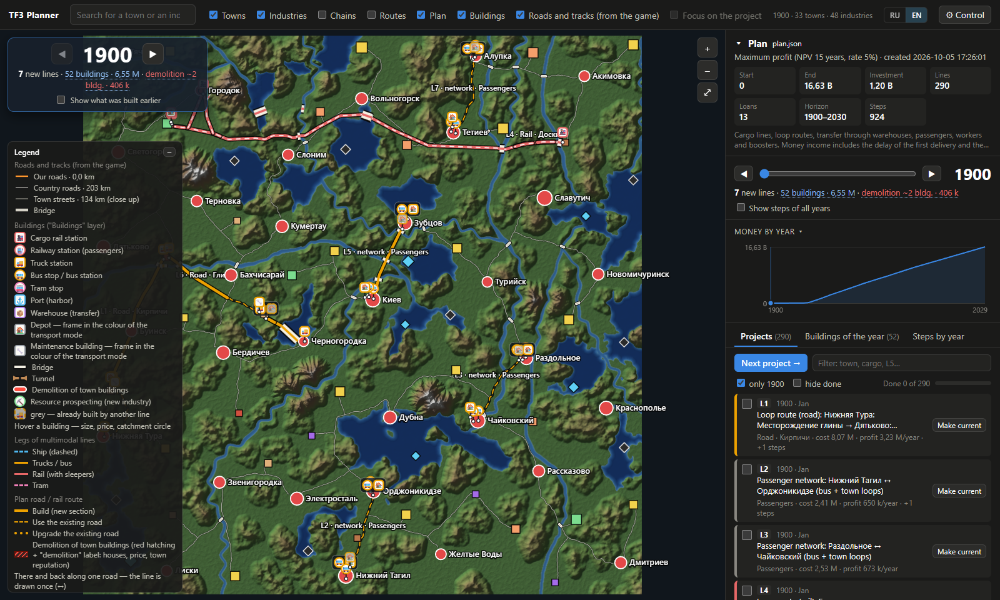
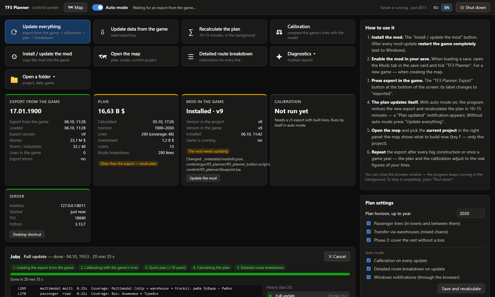
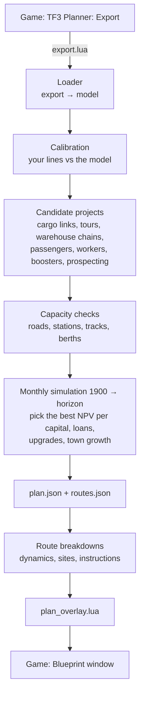

# TF3 Planner

**English** · [Русский](README.ru.md)

[](https://github.com/Staery/tf3-planner/actions/workflows/ci.yml)
[](https://www.python.org)


[](LICENSE)

A logistics planner for **Transport Fever 3**. A small in-game mod exports your map; a desktop program
works out a profitable network of cargo and passenger lines and a year-by-year build plan; and the
**Blueprint** window back in the game shows what to build, where, and in which order, project by project.

The plan is not a list of tips: the program simulates the economy month by month (money, loans, vehicles,
town growth, ageing fleets) and picks the projects with the best return, with routes laid over the real terrain
and the roads and tracks you have already built. Everything runs locally on your PC. The interface is in
**English and Russian**.

> **Game version.** Made and tested with **Transport Fever 3 build 40408** (Steam, October 2026), career mode
> on Very Hard. The game is new and its modding API is not documented; most rules were read from the game's
> own scripts. A game update can change them — see [Project status](#project-status).



<sub>The plan overview of a real career game (town and cargo names come from the save, in the game's language).
Below: the control center.</sub>



---

## What it consists of

| Part | Runs | What it does |
|---|---|---|
| **Mod "TF3 Planner"** (`mod/tf3_planner_1`) | in the game | The **TF3 Planner: Export** button saves the map: terrain, towns, industries, cargo chains, roads and tracks, stations, lines, vehicles, money and loans. The **Blueprint** window and the task bar show the plan right on the map, mark what is already built, highlight the game buttons you need and can build some constructions for you. |
| **Desktop program** (`tf3planner/`) | Windows, in the browser | The **control center** (`http://127.0.0.1:8010/control.html`) reads the export, recalculates the plan (automatically after every export), installs the mod and shows the game log. The **plan overview** (`/`) is an optional map of the whole plan with the money forecast and route breakdowns. |

The export works without the program; the Blueprint needs the program to compute a plan.

## Features

| | Feature | Where to look |
|---|---|---|
| 🗺 | **Export of the whole game state** through the official modding API: terrain, towns with statistics and buildings, industries and recipes, the road/track network, stations, lines, vehicles, loans | `mod/tf3_planner_1/content/tf3_planner/` |
| 🛤 | **Routing over the terrain**: grades, bridges, tunnels, viaducts, earthworks, demolition of town buildings; existing roads are reused | `tf3planner/routing.py`, `network.py`, `townmask.py` |
| 📈 | **Economics from the game's scripts**: production, boosters, payment per unit and metre, running costs, difficulty, company rank | `economics.py`, `model.py`, `vehicles.py` |
| 🧮 | **Network design as a MILP** (HiGHS): which producer feeds which consumer, by which mode, with shared infrastructure | `flow.py` |
| 🔁 | **Multi-stop routes**: milk runs and loops solved as TSP/VRP (own Lin–Kernighan, LKH-3, OR-Tools) | `tours.py` |
| 🏬 | **Multimodal chains through warehouses** (feeder → warehouse → trunk) | `multimodal.py` |
| 🚌 | **Passengers and workers**: demand model, town loops on real streets, intercity lines, worker lines that boost industries | `passengers.py` |
| 🏭 | **Industry growth**: boosters, workers, resource prospecting, production chains | `efficiency.py` |
| 🗓 | **Year-by-year plan**: monthly cash simulation, loans, vehicle replacement, track and road upgrades, town growth and company rank | `planner.py`, `upgrades.py`, `towns.py` |
| 🚦 | **Capacity checks**: road congestion, station terminals, single track with passing loops or double track, berths | `capacity.py`, `capacity_generic.py` |
| 🚂 | **Vehicle dynamics**: tractive effort, grades, curves, braking — real trip times and the steepest grade a train can climb | `dynamics.py` |
| 📋 | **Route breakdowns**: step-by-step instructions for every line, station and depot sites, warehouses, line settings | `dossier.py`, `siting.py`, `facilities.py` |
| 🎯 | **Calibration** against your running lines (income, costs, trip times) | `calibration.py` |
| 🧭 | **In-game Blueprint**: ghost zones on the map, task list with progress, highlighted game buttons, a **Build** button for roads and road stations | `overlay.py`, `blueprint.lua` |
| 🖥 | **Control center and plan overview** in the browser, automatic recalculation after each export | `tf3planner/control/`, `tf3planner/web/` |
| ⚡ | **Parallel planner**: generators run on all CPU cores; a full plan to 2030 takes ~15 minutes | `parallel.py` |
| 🌍 | **English and Russian** in the program, the plan texts and the in-game windows | `i18n.py`, `locales/en.json`, `web/static/i18n.js` |

## How the planner works



### 1. Export and model

The mod walks the game's entity system through the official API (`api.engine`, schema in `schema.lua`) and saves
the result with `app.saveUserdata` — the only file a mod may write. The program turns it into a model:
terrain (32 m heightmap), towns and their land use, industries with the **runtime** production rules,
the road/track graph, stations, lines and the vehicle catalogue (including vehicle mods). Industry recipes are
extracted from **your own** game install on the first run (`tools/extract_recipes.py`).

Economics follow the game scripts: maximum production = rule output × capacity × consumption factor × industry
productivity (0.5 on Very Hard), checked against the game for all 82 cargo figures; payment per unit is per metre
of the straight 3D distance between loading and unloading (+8× the climb); passengers pay 3.609 $/m × (0.5 +
price factor); prices in the export already include the difficulty multiplier.

### 2. Routes over the terrain (`routing.py`)

The heightmap is resampled to a 64 m grid; every node is linked to 16 neighbours (king + knight moves), so routes
turn in ~27° steps instead of 45°. Each edge is sampled every 8 m on the fine heightmap, which catches one-cell rivers.
The cost of an edge is

```text
length × (way price + years × upkeep) × (1 + 0.25 × (grade / allowed grade)²)
+ bridge over the wet part (height surcharge above 10 m)
+ the cheapest of earthworks / viaduct / tunnel for the grade above the allowed one
+ demolition of town buildings (≈ 25 175 $ × building capacity, plus a reputation penalty)
+ value of time (4 000 $/s × travel time at the way's speed)
```

Existing roads and tracks from the export cost only the value of time, so routes follow them when that is cheaper
than building. Roads are kept at ≤ 12 % grade (the game rejects steeper script-built roads). Shortest paths come
from SciPy Dijkstra; all-pairs matrices are cached on disk.

### 3. Candidate projects

Each generator returns `ProjectCandidate` objects with capital cost, yearly income and costs, the supply and demand
they use, and the infrastructure keys they build (so later projects reuse a road or a station for free):

* **Cargo links** (producer → consumer, rail / road / water) with the best vehicle for the era, fleet size and stations.
* **Network design** (`flow.py`): a fixed-charge, max-profit flow MILP over all cargoes and recipes solved by HiGHS,
  deciding which pairs to serve and how much to carry; boosters enter as linear terms.
* **Tours** (`tours.py`): milk runs and loops with several stops. TF3 cargo has no destination, so each unit is paid
  from its own pickup to its own drop-off; stop order is a TSP/VRP solved by Lin–Kernighan (own implementation),
  LKH-3 or OR-Tools, exact Held–Karp on small cases.
* **Warehouse chains** (`multimodal.py`): feeder → warehouse → trunk → consumer. Transfers are only possible through
  a warehouse in the catchment of both stations; payment is never more than the direct chord, so a chain wins only
  through cheaper transport or by making a link possible at all (oil platforms, fishing grounds).
* **Passengers and workers** (`passengers.py`): a gravity model of trips with a power-logit mode choice against walking
  and cars, coverage of stop catchments, Mohring frequency; town loops run on the real street network; worker lines
  to industries earn the ×1.5–2.5 production bonus (≥ 10 distinct residents within 2 years).
* **Industry growth** (`efficiency.py`): boosters (tools, machines, fertiliser), workers, resource prospecting by
  company rank, production chains.

### 4. Capacity checks (`capacity.py`, `capacity_generic.py`)

Every candidate is checked with the same rules: road lanes with a BPR slowdown and a jam density, entrance gates
and terminals of stations, berths of ports, and rail sections — single track with passing loops, platoons of trains,
or a second track. A project that does not fit gets more vehicles, more station modules or extra track, or is dropped.

### 5. The year-by-year plan (`planner.py`)

The planner simulates the game month by month from the export date to the horizon (2030 by default):

1. Each month, while cash plus available loans allow, it builds the candidate with the **best NPV per unit of capital**
   (15 years, 5 %) whose payback is under 12 years. Income starts with the first delivery, not the purchase.
2. **Loans** come from the export's offers, cheapest effective rate first; a taken slot gets a new average offer after
   ~6 months; loans are repaid early when spare cash has nothing better to do (interest in TF3 is flat).
3. Every January **upgrades** are considered (`upgrades.py`): fleet replacement by a defender/challenger comparison of
   equivalent annual costs (ageing raises running costs), better track or road types, electrification, passing loops
   and second tracks — each only if the saving pays it back.
4. **Towns grow** from the cargo and passengers the plan delivers (`towns.py`, the game's XP and rating formulas);
   new town demand and company rank feed the next years.
5. The result is `plan.json` (steps by year, money forecast) and `routes.json` (geometry).

### 6. Route breakdowns and the Blueprint

`dossier.py` turns each line of the plan into instructions: route sections with bridges and tunnels, a vehicle
dynamics simulation (`dynamics.py`: traction `min(TE, P/v)`, grade force `3.27 × grade × mass` as in the game GUI,
curve speeds from the track's `speedCoeffs`, braking) that gives real trip times and the steepest grade a loaded
train still climbs, station and depot sites (`siting.py`: depots outside towns within the maintenance radius,
stations next to industries on the route side, warehouses in both catchments), warehouses and line settings.

`overlay.py` writes `plan_overlay.lua`. The mod draws the selected project as ghost zones and markers, ticks off what
you have built (it compares the plan with the player-owned roads, tracks and constructions), highlights the needed
game buttons and, for roads and road stations, can place the construction itself after a dry-run check of cost and
collisions.

## Requirements

* **Windows 10/11 x64** and **Transport Fever 3** (Steam).
* **Python 3.13** ([python.org](https://www.python.org/downloads/)).
* 8 GB of RAM or more; a full plan uses all CPU cores for ~15 minutes on a large map.
* A modern browser.

## Installation (from source)

There is no download build yet, so the program runs from source.

```powershell
git clone https://github.com/Staery/tf3-planner.git
cd tf3-planner
python -m venv .venv
.venv\Scripts\pip install -r packaging\requirements.txt
.venv\Scripts\python -X utf8 -m tf3planner.config      # shows the game and user folders it found
```

The program finds Steam in the registry, the game in `libraryfolders.vdf` and your folder
`<Steam>\userdata\<id>\3493540\local`. If something is not found:

```powershell
.venv\Scripts\python -m tf3planner.config --set-game "D:\Games\Transport Fever 3"
.venv\Scripts\python -m tf3planner.config --set-userdata "D:\Steam\userdata\123\3493540\local"
```

(or the environment variables `TF3P_GAME`, `TF3P_USERDATA`, `TF3P_DATA`).

Then:

1. **Start the program**: double-click **`TF3 Planner.bat`** (or `.venv\Scripts\python -m tf3planner.control.launcher`).
   The control center opens in the browser; on the first start it extracts industry recipes from your game.
   *Create Desktop Shortcut.bat* puts a shortcut on the desktop.
2. **Install the mod**: press **Install / update the mod** in the control center (or run `./deploy.sh`). It copies
   `mod/tf3_planner_1` into `local\mods` and rebuilds `_content.json`. After every mod update **restart the game
   completely** (exit to Windows).
3. **Enable the mod in your save**: when loading a save, open the **Mods** tab in the save card and tick
   **TF3 Planner** (for a new game — when creating the map).

*Optional:* `powershell -ExecutionPolicy Bypass -File packaging\build.ps1 -Test -Zip` builds a standalone
`TF3Planner.exe` with Python included (see [docs/PUBLISHING.md](docs/PUBLISHING.md)).

## Usage

1. In the game press **TF3 Planner: Export** at the bottom of the screen (the label changes to *exported*).
2. With **auto mode** on, the control center notices the export and recalculates the plan; a *Plan updated*
   notification appears after ~10–15 minutes. Without auto mode press **Update everything**.
3. Back in the game, open the **Blueprint** window or use the task bar at the top: pick a project, press
   **Show on the map**, follow the steps. Steps that the game can check (built roads, stations, lines, vehicles,
   loans) are ticked automatically; others you mark as done.
4. Repeat the export after big constructions or once a game year: the plan and the calibration follow your real game.

The **plan overview** (`http://127.0.0.1:8010/`) is optional: the whole plan on one map, the money forecast by year,
all projects with progress and the detailed breakdown of every route. The language switch (RU / EN) is in the top
right corner of both pages; the Blueprint follows the same choice.

## Privacy

Everything runs **locally**. The server listens only on `127.0.0.1`, the pages load nothing from the internet, there is
no telemetry. The mod writes only into its own folder `userdata\…\local\tf3_planner\` through the official
`app.saveUserdata`; the program writes into its data folder and (with *Install the mod*) into `local\mods`.

## Project status

The planner is used in a real career game and covers the whole loop: export → plan → Blueprint → build → export.
It is written for **Transport Fever 3 build 40408**; a game update can change the modding API or the rules
(the export marks failed fields in `errors`, and recipes can be re-extracted with
`python -m tf3planner.firstrun --force`).

### Done

- [x] Export of the full game state (export v9), including the road/track network, town buildings, player constructions and line statistics
- [x] Routing over the terrain with bridges, tunnels, earthworks, demolition and reuse of existing roads
- [x] Cargo links, multi-stop tours, warehouse chains, passengers, workers, boosters and prospecting
- [x] Monthly simulation with loans, upgrades, fleet renewal, town growth and company rank
- [x] Capacity checks for roads, stations, rail sections and ports; vehicle dynamics
- [x] Route breakdowns with step-by-step instructions and building sites
- [x] In-game Blueprint: ghost zones, task list, progress checks, button highlighting, hot reload of the window
- [x] **Build** button for roads and road stations (dry run with cost and collisions first)
- [x] Control center with auto mode, game-log diagnostics and job history; plan overview map
- [x] Calibration against running lines; parallel planner
- [x] English and Russian interface, plan texts and in-game windows
- [x] Standalone build (PyInstaller) and mod packaging scripts

### Not done yet / known gaps

- [ ] Many model numbers are **assumptions** (town demand, trips per resident, ageing of vehicles); calibration improves them only for line types you already run
- [ ] **Build** button: no button yet for depots, maintenance buildings, warehouses, rail stations and tracks; road joints built by script sometimes need fixing by hand
- [ ] Industry access roads belong to the industry construction; the mod cannot connect to them by script
- [ ] The English plan texts are translated from the Russian originals by templates; some long breakdown sentences can still come out partly in Russian
- [ ] Only Windows and the Steam version are detected automatically
- [ ] The mod is not on mod.io yet and there is no download build: install from source

### Plans

- Publish the mod on mod.io and a release build of the program
- Build buttons for depots, warehouses, rail stations and tracks; fix lane connections at road joints
- Generate plan texts directly in the chosen language instead of translating finished text
- Calibrate demand and trips from the game's line statistics automatically
- Check the remaining assumptions against the game (open questions are listed in [docs/mechanics.md](docs/mechanics.md))

## Project layout

```text
.
├── mod/tf3_planner_1/              # the game mod (Lua 5.2)
│   └── content/
│       ├── tf3_planner/            # export.lua, dump.lua (+ schema.lua), network.lua, blueprint.lua …
│       └── gui/tf3_planner/        # the Export button, task bar and Blueprint window
├── tf3planner/                     # the desktop program (Python)
│   ├── loader.py  model.py  vehicles.py  economics.py  network.py  buildings.py
│   ├── routing.py  flow.py  tours.py  multimodal.py  passengers.py  efficiency.py
│   ├── planner.py  upgrades.py  towns.py  capacity.py  capacity_generic.py  parallel.py
│   ├── dynamics.py  dossier.py  siting.py  facilities.py  calibration.py  overlay.py
│   ├── i18n.py  locales/en.json    # Russian → English for everything the program shows
│   ├── control/                    # control center: jobs, auto mode, settings, game log, mod deploy
│   └── web/                        # FastAPI server, plan overview map, control center pages
├── tools/                          # recipe extraction, API schema generator, i18n string extractor
├── packaging/                      # PyInstaller build, installer script, mod packaging
├── docs/                           # research notes: game mechanics, strategies, audits, publishing
└── tests/                          # pytest suite (some tests use your local data/ and are skipped without it)
```

## Testing

```bash
.venv\Scripts\pip install pytest
.venv\Scripts\python -m pytest -q
```

The suite (≈ 250 tests) covers routing, economics, tours, passengers, capacity, dynamics, upgrades, town growth,
the overlay writer and the **Lua side of the mod** (export and Blueprint run under `lupa` with a mocked game API),
plus the translation catalogues. Tests that need a real export (`data/export.json`) are skipped when it is missing.

## Legal

TF3 Planner is an unofficial fan project, not affiliated with Urban Games or Paradox Interactive.
"Transport Fever" is their trademark and is used only to describe compatibility. The mod reads the game state
**only through the official modding API** and does not change game files. No game assets (models, textures,
scripts, texts) are distributed: industry recipes are extracted on the player's PC from their own install. The mod
contains only `schema.lua`, a list of API type and field names generated from the public Teal definitions for
modders. Details: [docs/PUBLISHING.md](docs/PUBLISHING.md).

## Acknowledgements

Urban Games for Transport Fever 3 and its open Lua API for mods. Libraries: NumPy, SciPy (the
[HiGHS](https://highs.dev) solver), Lupa (Lua in Python), FastAPI, Starlette, Uvicorn, Pydantic, Pillow,
Google OR-Tools, elkai (LKH-3 by K. Helsgaun — free for non-commercial use), PyInstaller.

## License

[MIT](LICENSE) © 2026 Staery. Third-party libraries keep their own licenses (LKH-3 via elkai: non-commercial use only).
