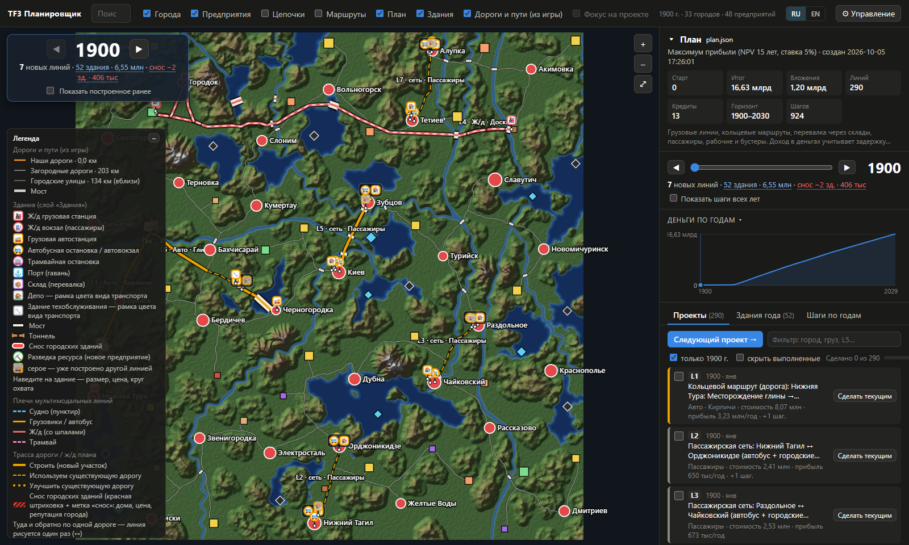
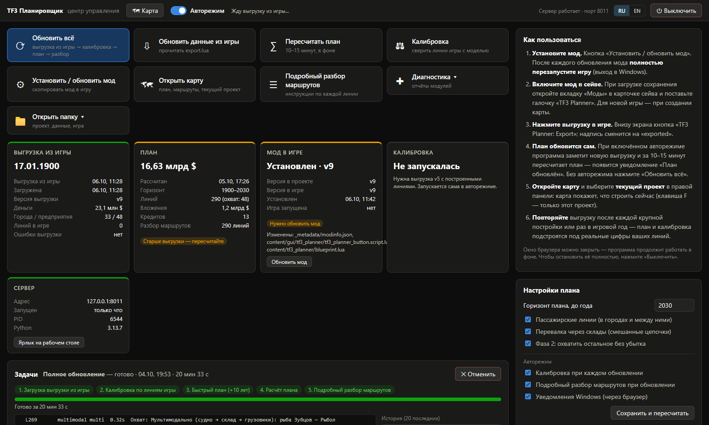
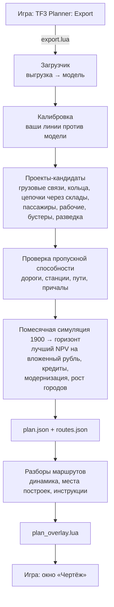

# TF3 Planner

[English](README.md) · **Русский**

[](https://github.com/Staery/tf3-planner/actions/workflows/ci.yml)
[](https://www.python.org)


[](LICENSE)

Планировщик логистики для **Transport Fever 3**. Небольшой мод выгружает карту из игры; настольная программа
рассчитывает выгодную сеть грузовых и пассажирских линий и план строительства по годам; а окно **«Чертёж»**
в игре показывает, что строить, где и в каком порядке — по проектам.

План — это не список советов: программа моделирует экономику помесячно (деньги, кредиты, техника, рост городов,
старение парка) и выбирает проекты с лучшей отдачей, а трассы прокладывает по реальному рельефу и по уже
построенным вами дорогам и путям. Всё работает локально на вашем компьютере. Интерфейс — на **русском и
английском**.

> **Версия игры.** Сделано и проверено на **Transport Fever 3, сборка 40408** (Steam, октябрь 2026), карьера
> на «Очень сложно». Игра новая, API модов не документирован, большинство правил взято из скриптов самой игры.
> Обновление игры может их изменить — см. [Состояние проекта](#состояние-проекта).



<sub>Обзор плана настоящей партии (названия городов и грузов берутся из сейва, на языке игры). Ниже — центр управления.</sub>



---

## Из чего состоит

| Часть | Где работает | Что делает |
|---|---|---|
| **Мод «TF3 Planner»** (`mod/tf3_planner_1`) | в игре | Кнопка **«TF3 Planner: Export»** сохраняет карту: рельеф, города, предприятия, цепочки грузов, дороги и пути, станции, линии, транспорт, деньги и кредиты. Окно **«Чертёж»** и строка задания показывают план прямо на карте, отмечают построенное, подсвечивают нужные кнопки игры и умеют сами ставить часть построек. |
| **Настольная программа** (`tf3planner/`) | Windows, в браузере | **Центр управления** (`http://127.0.0.1:8010/control.html`) читает выгрузку, пересчитывает план (автоматически после каждой выгрузки), ставит мод и показывает журнал игры. **Обзор плана** (`/`) — необязательная карта всего плана с прогнозом денег и подробными разборами маршрутов. |

Выгрузка работает и без программы; «Чертежу» нужна программа, чтобы рассчитать план.

## Возможности

| | Возможность | Где смотреть |
|---|---|---|
| 🗺 | **Выгрузка всего состояния игры** через официальный API модов: рельеф, города со статистикой и зданиями, предприятия и рецепты, сеть дорог и путей, станции, линии, транспорт, кредиты | `mod/tf3_planner_1/content/tf3_planner/` |
| 🛤 | **Трассировка по рельефу**: уклоны, мосты, тоннели, виадуки, насыпи, снос городских зданий; существующие дороги используются повторно | `tf3planner/routing.py`, `network.py`, `townmask.py` |
| 📈 | **Экономика по скриптам игры**: производство, бустеры, оплата за единицу и метр, расходы, сложность, ранг компании | `economics.py`, `model.py`, `vehicles.py` |
| 🧮 | **Проектирование сети как MILP** (HiGHS): кто кого снабжает, каким видом транспорта, с общей инфраструктурой | `flow.py` |
| 🔁 | **Многоостановочные маршруты**: сборные рейсы и кольца как TSP/VRP (свой Лин–Керниган, LKH-3, OR-Tools) | `tours.py` |
| 🏬 | **Мультимодальные цепочки через склады** (подвоз → склад → магистраль) | `multimodal.py` |
| 🚌 | **Пассажиры и рабочие**: модель спроса, городские кольца по реальным улицам, междугородние линии, линии рабочих с бонусом производства | `passengers.py` |
| 🏭 | **Рост предприятий**: бустеры, рабочие, разведка ресурсов, производственные цепочки | `efficiency.py` |
| 🗓 | **План по годам**: помесячная симуляция денег, кредиты, замена техники, модернизация путей и дорог, рост городов и ранг компании | `planner.py`, `upgrades.py`, `towns.py` |
| 🚦 | **Проверка пропускной способности**: заторы на дорогах, терминалы станций, однопутка с разъездами или второй путь, причалы | `capacity.py`, `capacity_generic.py` |
| 🚂 | **Динамика движения**: сила тяги, уклоны, кривые, торможение — реальное время рейса и предельный уклон для поезда | `dynamics.py` |
| 📋 | **Разборы маршрутов**: пошаговые инструкции по каждой линии, места станций и депо, склады, настройки линий | `dossier.py`, `siting.py`, `facilities.py` |
| 🎯 | **Калибровка** по вашим работающим линиям (доход, расходы, время рейса) | `calibration.py` |
| 🧭 | **«Чертёж» в игре**: призрачные зоны на карте, список задач с прогрессом, подсветка кнопок игры, кнопка **«Построить»** для дорог и дорожных станций | `overlay.py`, `blueprint.lua` |
| 🖥 | **Центр управления и обзор плана** в браузере, автоматический пересчёт после каждой выгрузки | `tf3planner/control/`, `tf3planner/web/` |
| ⚡ | **Параллельный планировщик**: генераторы работают на всех ядрах; полный план до 2030 — около 15 минут | `parallel.py` |
| 🌍 | **Русский и английский** в программе, текстах плана и окнах в игре | `i18n.py`, `locales/en.json`, `web/static/i18n.js` |

## Как работает планировщик



### 1. Выгрузка и модель

Мод обходит систему сущностей игры через официальный API (`api.engine`, схема — в `schema.lua`) и сохраняет
результат через `app.saveUserdata` — единственный файл, который мод может записать. Программа строит из него
модель: рельеф (карта высот 32 м), города и их застройку, предприятия с **рабочими** (runtime) правилами
производства, граф дорог и путей, станции, линии и каталог техники (включая моды на технику). Рецепты производств
при первом запуске извлекаются из **вашей** установки игры (`tools/extract_recipes.py`).

Экономика — по скриптам игры: максимальное производство = выход правила × ёмкость × коэффициент потребления ×
производительность предприятий (0,5 на «Очень сложно»), сверено с игрой для всех 82 значений грузов; оплата за
единицу — за метр прямого 3D-расстояния между погрузкой и выгрузкой (+8× подъём); пассажиры — 3,609 $/м × (0,5 +
коэффициент цены); цены в выгрузке уже включают множитель сложности.

### 2. Трассы по рельефу (`routing.py`)

Карта высот пересчитывается в сетку 64 м; каждый узел связан с 16 соседями (ходы короля и коня), поэтому трассы
поворачивают с шагом ~27°, а не 45°. Каждое ребро проверяется по мелкой карте высот через каждые 8 м — так ловятся
реки шириной в одну клетку. Стоимость ребра:

```text
длина × (цена пути + годы × содержание) × (1 + 0,25 × (уклон / допустимый)²)
+ мост над водой (надбавка за высоту выше 10 м)
+ самое дешёвое из насыпи/выемки, виадука или тоннеля для уклона сверх допустимого
+ снос городских зданий (≈ 25 175 $ × вместимость здания, плюс штраф за репутацию)
+ ценность времени (4 000 $/с × время в пути на скорости этого пути)
```

Существующие дороги и пути из выгрузки стоят только ценность времени, поэтому трасса идёт по ним, когда это
выгоднее стройки. Дороги держатся в уклоне ≤ 12 % (игра отвергает более крутые дороги, построенные скриптом).
Кратчайшие пути — Дейкстра из SciPy; матрицы «все со всеми» кэшируются на диске.

### 3. Проекты-кандидаты

Каждый генератор возвращает `ProjectCandidate`: вложения, доход и расходы в год, какое предложение и спрос он
использует и какую инфраструктуру строит (следующие проекты получают эту дорогу или станцию бесплатно):

* **Грузовые связи** (производитель → потребитель, ж/д / авто / вода) с лучшей техникой эпохи, размером парка и станциями.
* **Проектирование сети** (`flow.py`): MILP максимальной прибыли с фиксированными затратами по всем грузам и
  рецептам, решается HiGHS — какие пары обслуживать и сколько возить; бустеры входят линейно.
* **Кольца и сборные рейсы** (`tours.py`): у груза в TF3 нет адреса, поэтому каждая единица оплачивается от своей
  погрузки до своей выгрузки; порядок остановок — TSP/VRP: свой Лин–Керниган, LKH-3 или OR-Tools, точный
  Хелд–Карп на малых задачах.
* **Цепочки через склады** (`multimodal.py`): подвоз → склад → магистраль → потребитель. Перевалка возможна только
  через склад в охвате обеих станций; оплата не больше прямой хорды, поэтому цепочка выигрывает только дешёвым
  транспортом или тем, что вообще делает связь возможной (нефтяные платформы, рыболовные участки).
* **Пассажиры и рабочие** (`passengers.py`): гравитационная модель поездок с выбором вида транспорта (power-logit
  против пешком и на машине), охват остановок, частота по Мохрингу; городские кольца идут по реальной сети улиц;
  линии рабочих на предприятия дают бонус производства ×1,5–2,5 (≥ 10 разных жителей за 2 года).
* **Рост предприятий** (`efficiency.py`): бустеры (инструменты, станки, удобрения), рабочие, разведка ресурсов по
  рангу компании, производственные цепочки.

### 4. Пропускная способность (`capacity.py`, `capacity_generic.py`)

Каждый кандидат проверяется по одним правилам: полосы дорог с замедлением по BPR и плотностью затора, въезды и
терминалы станций, причалы портов, ж/д перегоны — однопутка с разъездами, пакеты поездов или второй путь. Проект,
который не помещается, получает больше техники, модулей станций или путей, либо отбрасывается.

### 5. План по годам (`planner.py`)

Планировщик моделирует игру помесячно от даты выгрузки до горизонта (по умолчанию 2030):

1. Каждый месяц, пока позволяют деньги и доступные кредиты, строится кандидат с **лучшим NPV на единицу вложений**
   (15 лет, 5 %) и окупаемостью меньше 12 лет. Доход начинается с первой доставки, а не с покупки.
2. **Кредиты** берутся из предложений выгрузки, сначала самые дешёвые по эффективной ставке; на место взятого через
   ~6 месяцев приходит новое среднее предложение; кредиты гасятся досрочно, когда свободным деньгам больше нечего
   делать (проценты в TF3 простые).
3. Каждый январь рассматривается **модернизация** (`upgrades.py`): замена парка по сравнению годовых эквивалентных
   затрат старого и нового (старение повышает расходы), лучшие типы путей и дорог, электрификация, разъезды и второй
   путь — только если экономия окупает вложения.
4. **Города растут** от доставленных планом грузов и пассажиров (`towns.py`, формулы опыта и рейтингов игры); новый
   спрос городов и ранг компании влияют на следующие годы.
5. Результат — `plan.json` (шаги по годам, прогноз денег) и `routes.json` (геометрия).

### 6. Разборы маршрутов и «Чертёж»

`dossier.py` превращает каждую линию плана в инструкции: участки трассы с мостами и тоннелями, симуляция движения
(`dynamics.py`: тяга `min(TE, P/v)`, сила уклона `3,27 × уклон × масса`, как в окне покупки техники, скорость в
кривых по `speedCoeffs` пути, торможение) с реальным временем рейса и предельным уклоном для гружёного поезда,
места станций и депо (`siting.py`: депо вне города в радиусе обслуживания, станции рядом с предприятием со стороны
трассы, склады в охвате обеих станций), склады и настройки линий.

`overlay.py` пишет `plan_overlay.lua`. Мод рисует выбранный проект призрачными зонами и маркерами, отмечает то, что
вы уже построили (сравнивает план с дорогами, путями и постройками игрока), подсвечивает нужные кнопки игры, а
дороги и дорожные станции может поставить сам — после пробной проверки стоимости и столкновений.

## Что нужно

* **Windows 10/11 x64** и **Transport Fever 3** (Steam).
* **Python 3.13** ([python.org](https://www.python.org/downloads/)).
* 8 ГБ оперативной памяти или больше; полный план на большой карте загружает все ядра процессора около 15 минут.
* Современный браузер.

## Установка (из исходников)

Готовой сборки для скачивания пока нет, поэтому программа запускается из исходников.

```powershell
git clone https://github.com/Staery/tf3-planner.git
cd tf3-planner
python -m venv .venv
.venv\Scripts\pip install -r packaging\requirements.txt
.venv\Scripts\python -X utf8 -m tf3planner.config      # покажет найденные папки игры и пользователя
```

Программа сама находит Steam (реестр), игру (`libraryfolders.vdf`) и вашу папку
`<Steam>\userdata\<id>\3493540\local`. Если что-то не нашлось:

```powershell
.venv\Scripts\python -m tf3planner.config --set-game "D:\Games\Transport Fever 3"
.venv\Scripts\python -m tf3planner.config --set-userdata "D:\Steam\userdata\123\3493540\local"
```

(или переменные окружения `TF3P_GAME`, `TF3P_USERDATA`, `TF3P_DATA`).

Дальше:

1. **Запустите программу**: двойной щелчок по **`TF3 Planner.bat`** (или `.venv\Scripts\python -m tf3planner.control.launcher`).
   В браузере откроется центр управления; при первом запуске он извлечёт рецепты производств из вашей игры.
   *Create Desktop Shortcut.bat* создаёт ярлык на рабочем столе.
2. **Установите мод**: кнопка **«Установить / обновить мод»** в центре управления (или `./deploy.sh`). Она копирует
   `mod/tf3_planner_1` в `local\mods` и пересобирает `_content.json`. После каждого обновления мода **полностью
   перезапустите игру** (выход в Windows).
3. **Включите мод в сейве**: при загрузке сохранения откройте вкладку **«Моды»** в карточке сейва и отметьте
   **TF3 Planner** (для новой игры — при создании карты).

*Необязательно:* `powershell -ExecutionPolicy Bypass -File packaging\build.ps1 -Test -Zip` собирает отдельный
`TF3Planner.exe` со встроенным Python (см. [docs/PUBLISHING.md](docs/PUBLISHING.md)).

## Как пользоваться

1. В игре нажмите **«TF3 Planner: Export»** внизу экрана (надпись сменится на *exported*).
2. При включённом **авторежиме** центр управления заметит выгрузку и пересчитает план; через 10–15 минут появится
   уведомление «План обновлён». Без авторежима нажмите **«Обновить всё»**.
3. В игре откройте окно **«Чертёж»** или используйте строку задания вверху экрана: выберите проект, нажмите
   **«Показать на карте»**, идите по шагам. Шаги, которые игра может проверить (построенные дороги, станции, линии,
   техника, кредиты), отмечаются сами; остальные отмечаете вы.
4. Повторяйте выгрузку после крупных строек или раз в игровой год — план и калибровка подстроятся под вашу игру.

**Обзор плана** (`http://127.0.0.1:8010/`) необязателен: весь план на одной карте, прогноз денег по годам, все проекты
с прогрессом и подробный разбор каждого маршрута. Переключатель языка (RU / EN) — в правом верхнем углу обеих
страниц; «Чертёж» в игре следует тому же выбору.

## Конфиденциальность

Всё работает **локально**. Сервер слушает только `127.0.0.1`, страницы ничего не загружают из интернета, телеметрии
нет. Мод пишет только в свою папку `userdata\…\local\tf3_planner\` через официальный `app.saveUserdata`; программа
пишет в свою папку данных и (кнопкой «Установить мод») в `local\mods`.

## Состояние проекта

Планировщик используется в настоящей карьерной партии и закрывает весь цикл: выгрузка → план → «Чертёж» → стройка →
выгрузка. Он написан под **Transport Fever 3, сборка 40408**; обновление игры может изменить API модов или правила
(выгрузка помечает упавшие поля в `errors`, рецепты можно извлечь заново командой
`python -m tf3planner.firstrun --force`).

### Сделано

- [x] Выгрузка всего состояния игры (экспорт v9), включая сеть дорог и путей, здания городов, постройки игрока и статистику линий
- [x] Трассировка по рельефу с мостами, тоннелями, насыпями, сносом и повторным использованием существующих дорог
- [x] Грузовые связи, многоостановочные кольца, цепочки через склады, пассажиры, рабочие, бустеры и разведка
- [x] Помесячная симуляция с кредитами, модернизацией, обновлением парка, ростом городов и рангом компании
- [x] Проверка пропускной способности дорог, станций, ж/д перегонов и портов; динамика движения
- [x] Разборы маршрутов с пошаговыми инструкциями и местами построек
- [x] «Чертёж» в игре: призрачные зоны, список задач, проверка прогресса, подсветка кнопок, горячее обновление окна
- [x] Кнопка **«Построить»** для дорог и дорожных станций (сначала пробная проверка стоимости и столкновений)
- [x] Центр управления с авторежимом, разбором журнала игры и историей задач; карта обзора плана
- [x] Калибровка по работающим линиям; параллельный планировщик
- [x] Интерфейс, тексты плана и окна в игре на русском и английском
- [x] Отдельная сборка (PyInstaller) и скрипты упаковки мода

### Ещё не сделано / известные пробелы

- [ ] Многие числа модели — **допущения** (спрос городов, поездки на жителя, старение техники); калибровка уточняет их только для тех видов линий, что у вас уже есть
- [ ] Кнопка **«Построить»**: пока нет для депо, зданий техобслуживания, складов, ж/д станций и путей; стыки дорог, построенных скриптом, иногда приходится поправлять вручную
- [ ] Подъездные дороги предприятий — часть постройки предприятия, скриптом к ним не подключиться
- [ ] Английские тексты плана переводятся из русских оригиналов по шаблонам; длинные предложения разборов иногда остаются частично на русском
- [ ] Автоматически находятся только Windows и Steam-версия игры
- [ ] Мода ещё нет на mod.io и нет сборки для скачивания: установка из исходников

### Планы

- Выложить мод на mod.io и сборку программы для скачивания
- Кнопки «Построить» для депо, складов, ж/д станций и путей; исправить соединения полос на стыках дорог
- Генерировать тексты плана сразу на выбранном языке, а не переводить готовый текст
- Автоматически калибровать спрос и поездки по статистике линий из игры
- Проверить оставшиеся допущения в игре (открытые вопросы — в [docs/mechanics.md](docs/mechanics.md))

## Структура проекта

```text
.
├── mod/tf3_planner_1/              # мод для игры (Lua 5.2)
│   └── content/
│       ├── tf3_planner/            # export.lua, dump.lua (+ schema.lua), network.lua, blueprint.lua …
│       └── gui/tf3_planner/        # кнопка экспорта, строка задания и окно «Чертёж»
├── tf3planner/                     # настольная программа (Python)
│   ├── loader.py  model.py  vehicles.py  economics.py  network.py  buildings.py
│   ├── routing.py  flow.py  tours.py  multimodal.py  passengers.py  efficiency.py
│   ├── planner.py  upgrades.py  towns.py  capacity.py  capacity_generic.py  parallel.py
│   ├── dynamics.py  dossier.py  siting.py  facilities.py  calibration.py  overlay.py
│   ├── i18n.py  locales/en.json    # перевод всего, что показывает программа, с русского на английский
│   ├── control/                    # центр управления: задачи, авторежим, настройки, журнал игры, установка мода
│   └── web/                        # сервер FastAPI, карта обзора плана, страницы центра управления
├── tools/                          # извлечение рецептов, генератор схемы API, сбор строк для перевода
├── packaging/                      # сборка PyInstaller, установщик, упаковка мода
├── docs/                           # исследования: механики игры, стратегии, аудиты, публикация
└── tests/                          # тесты pytest (часть использует ваши локальные data/ и без них пропускается)
```

## Тесты

```bash
.venv\Scripts\pip install pytest
.venv\Scripts\python -m pytest -q
```

Около 250 тестов проверяют трассировку, экономику, кольца, пассажиров, пропускную способность, динамику,
модернизацию, рост городов, запись файла «Чертежа» и **Lua-часть мода** (выгрузка и «Чертёж» исполняются в `lupa`
с заглушкой API игры), а также словари перевода. Тесты, которым нужна настоящая выгрузка (`data/export.json`),
без неё пропускаются.

## Правовое

TF3 Planner — неофициальный фанатский проект, не связан с Urban Games и Paradox Interactive. «Transport Fever» — их
товарный знак, упоминается только для описания совместимости. Мод читает состояние игры **только через официальный
API модов** и не изменяет файлы игры. Ресурсы игры (модели, текстуры, скрипты, тексты) **не распространяются**:
рецепты производств извлекаются на компьютере игрока из его собственной установки. В моде есть только `schema.lua` —
список имён типов и полей API, сгенерированный из публичных определений Teal для моддеров. Подробнее —
[docs/PUBLISHING.md](docs/PUBLISHING.md).

## Благодарности

Urban Games — за Transport Fever 3 и открытый Lua-API для модов. Библиотеки: NumPy, SciPy (решатель
[HiGHS](https://highs.dev)), Lupa (Lua в Python), FastAPI, Starlette, Uvicorn, Pydantic, Pillow, Google OR-Tools,
elkai (LKH-3, K. Helsgaun — бесплатно для некоммерческого использования), PyInstaller.

## Лицензия

[MIT](LICENSE) © 2026 Staery. Сторонние библиотеки — под своими лицензиями (LKH-3 через elkai — только некоммерческое использование).
